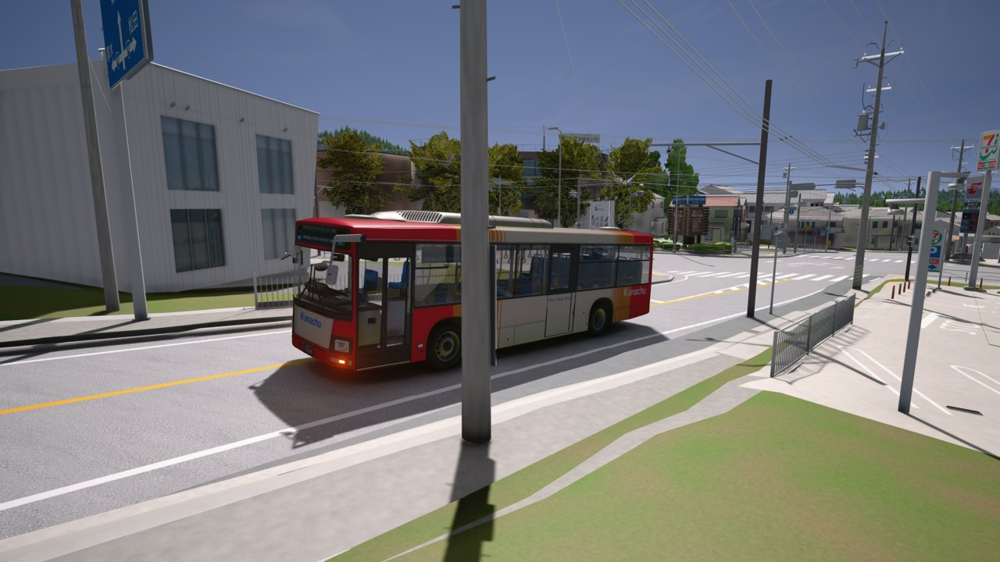
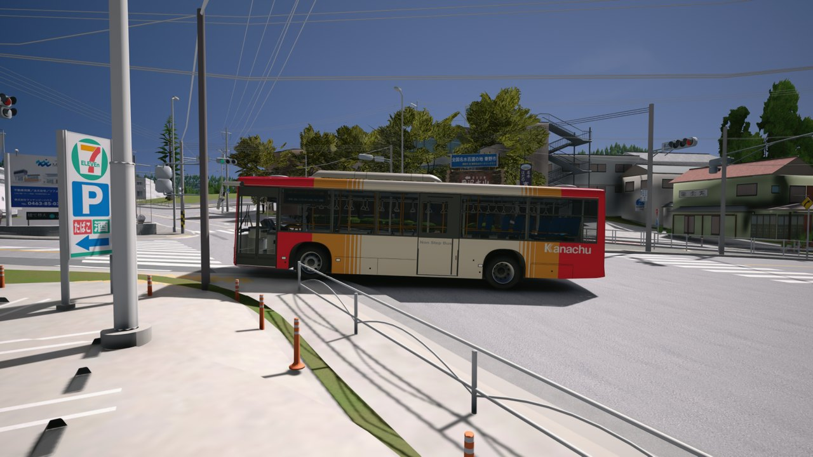
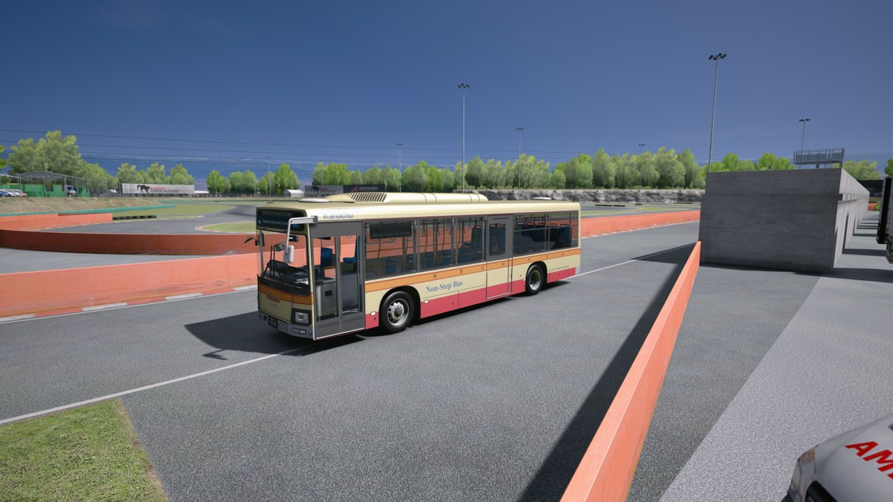
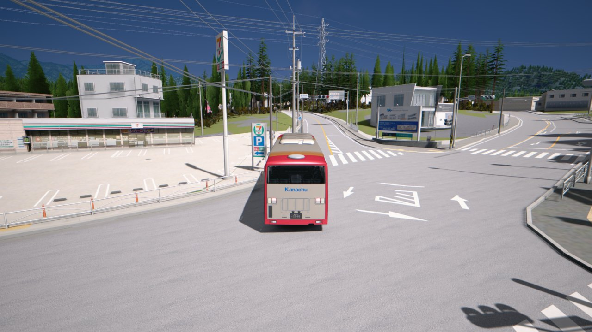
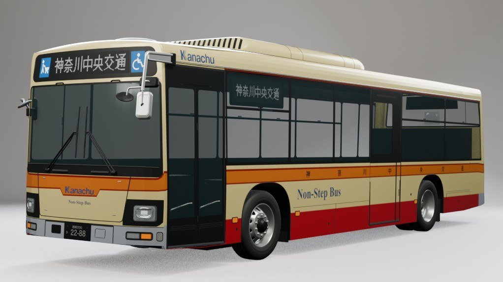
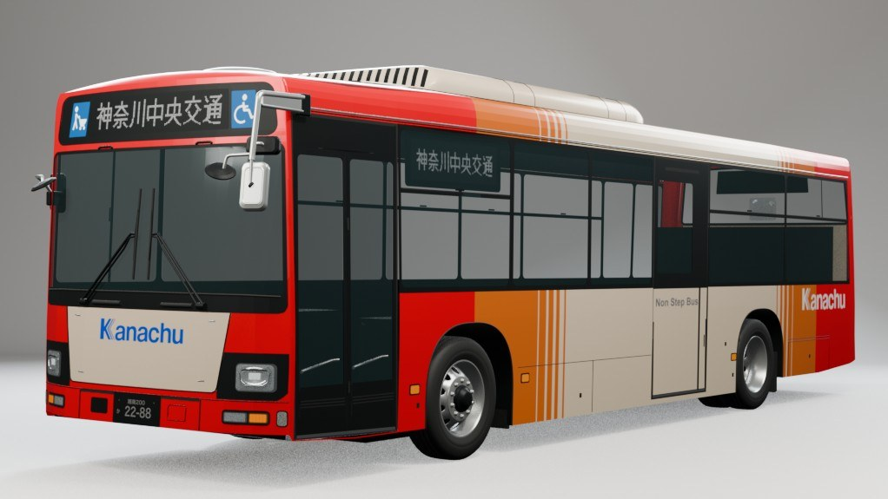
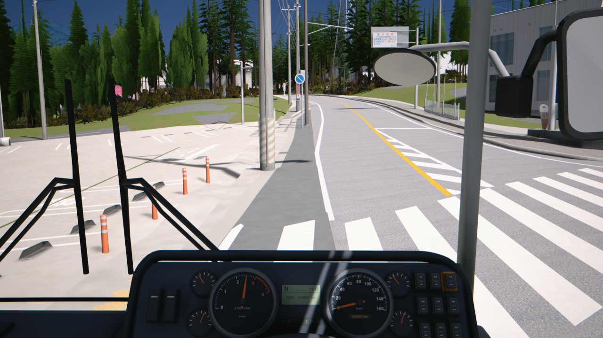
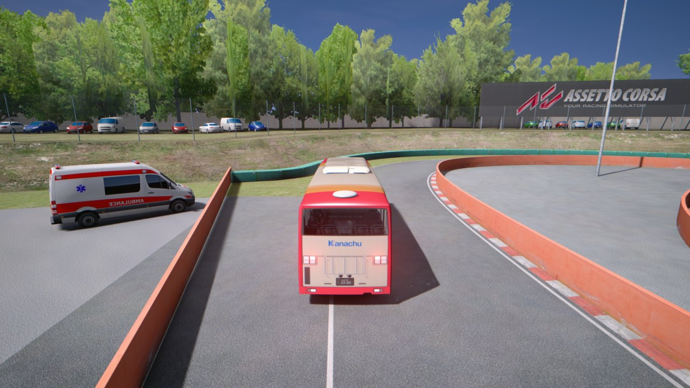
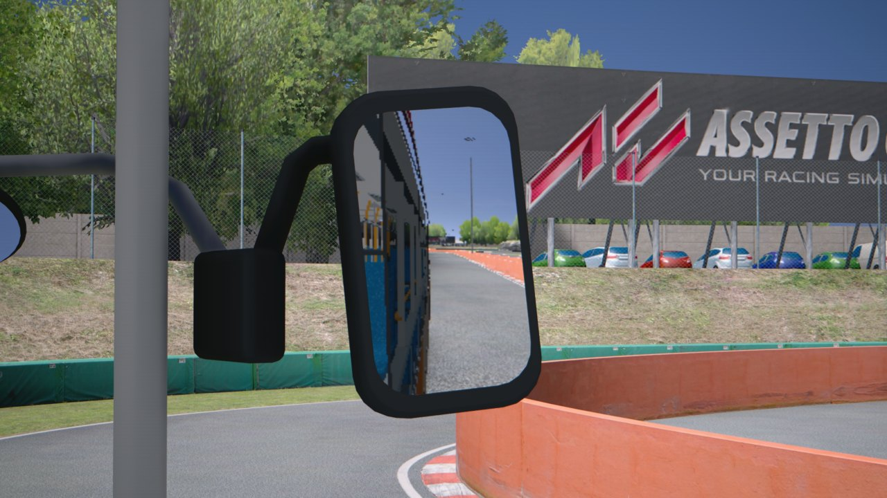
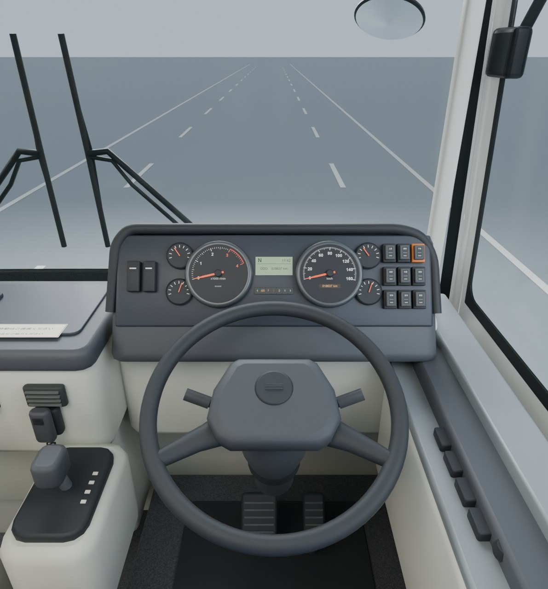

# 神奈中 路線バス — Assetto Corsa 車 MOD（非公式）

> **これは神奈川中央交通株式会社の公式の制作物ではありません。** ファンが個人で作った非公式の MOD で、神奈川中央交通株式会社、いすゞ自動車株式会社、Kunos Simulazioni とは一切関係がありません。「神奈中」「Kanachu」の名称・ロゴ・塗装は、それぞれの権利者のものです。お問い合わせを各社へ送らないでください。

神奈中（神奈川中央交通）でよく見かける大型ノンステップの路線バスを、Assetto Corsa（PC 版）で運転できるようにした車 MOD です。基準にした車種は、いすゞ エルガ（LV290 系、短尺の N 尺、全長 10.43 m）です。メーカーのエンブレムは付けていません。



## 外観

| 新塗装（2023 年度〜） | 旧塗装 |
|---|---|
|  |  |
|  |  |
|  | |

ゲームの中の画像は、Assetto Corsa で撮ったものです（コース：ヤビツ峠周辺の自作コース、Kunos の drift）。見本の 2 枚は Blender のレンダーです。

## 特徴

- **外装・内装を一から製作**：運転席（計器・ハンドル・料金箱）と客室（座席・手すり・つり革）まで作っています。
- **オリジナルの運転士**：神奈中の制服を着た運転士（帽子の徽章と胸の刺繍は描き直した字）が運転席に座り、ハンドルを回します。モデルは MIT のオリジナルで、Kunos や他の MOD のものは使っていません。
- **塗装 2 種**：新塗装（2023 年度〜）と旧塗装（クリーム地に赤・橙の帯）。ロゴと文字はすべて描き直しています。
- **走りは諸元から**：車両重量 9,790 kg、169 kW・773 N·m のディーゼル、回転は 2,600 rpm まで。加速はゆっくりで、最小旋回半径は約 8.3 m です。
- **自作のエンジン音**：フリー素材（Pixabay）のバスやトラックの音から、回転数ごとの音を作り直しています。扉の開閉音とエアブレーキの音も入っています。
- **灯火**（CSP）：ヘッドライト、尾灯、ブレーキ灯、ウインカー・非常点滅、バック灯、光る行先表示（「神奈川中央交通」）。
- **バックミラー**：左右 5 枚の鏡に、後ろの景色が映ります。
- **後ろから見る視点**：F6 の車載カメラの 4 番目と 5 番目は、バスの後ろ上方から見る視点です（下の「使い方」を参照）。

| 運転席 | F6 の後方カメラ | バックミラー |
|---|---|---|
|  |  |  |



## 動作環境

- Assetto Corsa（PC 版、Steam）
- Custom Shaders Patch（CSP）：推奨。灯火の光り方と本物の鏡は CSP の機能です。動作は CSP を入れた環境でだけ確かめています。
- Content Manager：無くても使えます。

## 導入

1. [Releases](../../releases) から `kanachu_route_bus.zip` を取ってきます。
2. zip を `assettocorsa/` フォルダの中に展開します。zip は AC の `content/` と同じ形で、次の 2 か所に入ります。
   - `content/cars/kanachu_route_bus/`：車
   - `content/driver/kanachu_driver.kn5`：運転士のモデル（車が使います）
3. Content Manager で zip を入れた場合は、入れた後に `assettocorsa/content/driver/kanachu_driver.kn5` があるかを確かめてください。無ければ、zip の中の同じファイルを手でそこに置きます（Content Manager が運転士のモデルまで入れるかは、確かめていません）。
4. ゲームの車の選択で「Kanachu City Bus (Large Non-step)」を選びます。

## 使い方

- **後ろから見たいとき**：F1 の追従カメラは、Assetto Corsa の仕様で全車共通の距離です。全長 10 m を超えるバスでは、車体の後ろが画面を覆ってしまいます。代わりに **F6** を押して、4 番目（近い）か 5 番目（遠い）の後方カメラを使ってください。
- **変速**：トルクコンバーター付きの AT は再現していません。自動変速で走ってください。
- **スキン**：既定は新塗装（`0_new2023`）、もう 1 つが旧塗装（`1_standard`）です。

## 実車との違い・既知の問題

- 物理の値の多く（ばね、減衰、重心の高さ、ブレーキ、空気抵抗など）は、公表値が無いため仮定です。加速や最高速（約 100 km/h）は、その仮定のもとで計算した値です。
- 横方向のグリップは、実車のバスに近づけるため低めにしています。限界の値は測りきれていません。
- 後輪は、見た目はダブルタイヤですが、物理は幅の広いタイヤ 1 本で近似しています。
- エンジン音は 4HK1（実車のエンジン）の録音ではありません。
- 尾灯のレンズは、消えているときに白っぽく見えます。
- 扉・窓・床の高さは、写真から推定しています。
- 社番、ナンバーの実番号、ステッカー類は付けていません。

## ソースから組み立てる

このリポジトリには、車 MOD をソースから組み立てるスクリプトが入っています。

必要なもの：

- Python 3.12（numpy、Pillow、pytest）
- Blender 5.x：外装・内装の .blend を kn5 に書き出すのに使います。`blender` にパスが通っていない場合は、環境変数 `BLENDER` に実行ファイルの場所を入れてください。
- FMOD Studio 1.08.12：音の bank を作り直すときだけ要ります。できた bank（`audio/build/kanachu_route_bus.bank`）は同梱しています。

```sh
python3 tools/assemble.py     # build/kanachu_route_bus/、build/driver/kanachu_driver.kn5、build/kanachu_route_bus.zip を作る
python3 tools/validate.py     # 組み上がった車の検査（必要なファイル、kn5 のノード、鏡など）
python3 -m pytest -q          # テスト
```

### 音の bank を作り直す

エンジン音の素材（`design/sound/engine/`、`design/sound/effects/`）は、Pixabay の録音を合成・編集して作った音です。作り方と元の録音の区間は `design/sound/samples.md` にあります。bank は Windows の FMOD Studio 1.08.12 で作ります。

```sh
GAME_PC=<Windows の ssh ホスト名> python3 tools/fmod_build.py build
```

### 公開前の検査

```sh
PUBLIC_FORBID=<ホスト名> python3 tools/check_public.py
```

git に入っているファイルと配布する zip に、手元の絶対パス（`/Users/<名前>` や `C:\Users\<名前>` は `PUBLIC_FORBID` に書かなくても検出します。`PUBLIC_FORBID` には公開したくない語、たとえばホスト名をコンマ区切りで渡します）や、公開しない場所のファイル（参考写真の比較画像、PDF、`vendor/` 以下）や、他の MOD から借りたファイルと同じ中身のファイルが無いかを調べます。.blend は圧縮されているので、展開してから調べます。

主なフォルダ：

| フォルダ | 中身 |
|---|---|
| `tools/` | kn5 の読み書き、物理（`data/`）の生成、灯火・鏡・UI・スキン・音の組み込み、検査 |
| `tools/spec.json` | 諸元と仮定の値。値ごとに出典（公式諸元／計算／仮定）を書いています |
| `design/` | 外装・内装・運転士の .blend、塗装、UI の絵、エンジン音の素材 |
| `audio/` | FMOD のプロジェクトと、できた bank |
| `docs/` | 設計書、作業の記録 |
| `tools/ac/` | 開発に使った、ゲームを自動で走らせて記録する仕組み。Windows のゲーム PC に ssh で入れることが前提で、ホスト名は環境変数 `GAME_PC`（または `tools/ac/local.env`）で指定します |

## 素材・クレジット

- **エンジン音・効果音**：[Pixabay](https://pixabay.com/) の効果音を加工し、音の bank（`sfx/kanachu_route_bus.bank`）に組み込んで使っています（[Pixabay Content License](https://pixabay.com/service/license/)）。
  - [chugging diesel (bus) and rev（ID 23478）](https://pixabay.com/ja/sound-effects/%E5%B8%82-chugging-diesel-bus-and-rev-23478/)
  - [bus interior（ID 22321）](https://pixabay.com/ja/sound-effects/%E5%B8%82-bus-interior-22321/)
  - [Bus doors open-close（ID 58149）](https://pixabay.com/ja/sound-effects/%E5%B8%82-bus-doors-open-close-58149/)
  - [air_brakes_loud_fade_out（ID 96993）](https://pixabay.com/ja/sound-effects/%E6%98%A0%E7%94%BB%E3%81%A8%E7%89%B9%E6%AE%8A%E5%8A%B9%E6%9E%9C-air-brakes-loud-fade-out-96993/)
- **諸元**：いすゞ自動車が公開している諸元表と旋回軌跡図を参考にしました。
- **音の組み立て**：Kunos Simulazioni の Assetto Corsa 音声 SDK のひな形を使っています。

## ライセンス

このプロジェクトで作ったコードと素材（3D モデル、テクスチャ、UI の絵、設定ファイル）は [MIT ライセンス](LICENSE) です。ただし、次のものには MIT は及びません。

- 「神奈中」「Kanachu」「神奈川中央交通」の名称、ロゴ、塗装のデザインは、神奈川中央交通株式会社の商標・意匠です。このプロジェクトは使用の許諾を受けていません。
- エンジン音・効果音は、Pixabay の効果音を加工した音で、[Pixabay Content License](https://pixabay.com/service/license/) にも従います。
- `audio/fmod_template/` は、Kunos Simulazioni の Assetto Corsa 音声 SDK のひな形をもとにしています。

---

## English summary

**Unofficial** fan-made Assetto Corsa car mod of a Kanachu (Kanagawa Chuo Kotsu) city bus, modelled after the Isuzu Erga (LV290, 10.43 m). Not affiliated with or endorsed by Kanagawa Chuo Kotsu Co., Ltd., Isuzu Motors, or Kunos Simulazioni; all names, logos and liveries belong to their owners.

License: MIT for the code and original assets (see LICENSE); names, logos and liveries are not covered.

Install: extract the zip into your `assettocorsa/` folder. It installs `content/cars/kanachu_route_bus` and the original driver model `content/driver/kanachu_driver.kn5` (MIT, no Kunos or third-party files). If you install with Content Manager, check that `assettocorsa/content/driver/kanachu_driver.kn5` exists afterwards and copy it there by hand if not (we have not verified that Content Manager installs the driver model). CSP is recommended (lights, real mirrors). AC's F1 chase camera uses one distance for all cars and ends up right behind a 10 m bus, so use **F6** cameras 4 and 5 for a rear view.
